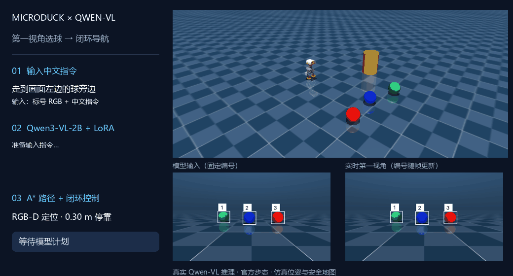
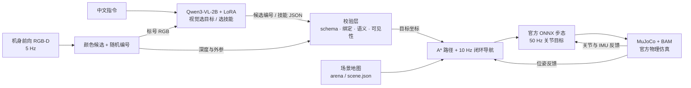

# MicroDuck × Qwen-VL：中文视觉语言导航



**视觉方案本机实录：中文指令 + 第一视角 RGB → Qwen3-VL 选目标 / 选技能 → RGB-D 定位 → MuJoCo 闭环导航。** 左下角为实际送入模型的固定编号图片，右下角为持续更新的第一视角，上方为同一次物理运行的第三人称视图。位姿、相机外参与安全地图仍来自仿真，单次演示不代表多场景成功率。[视觉录制记录](assets/vision-navigation-demo.json)

> 本项目**只保留视觉语言（VLM）链路**：图像 + 中文指令 → 结构化 JSON → 校验 → 控制机器人。
> 早期纯文本 Qwen 导航分支（Qwen3-0.6B，无图像输入）已移除。
> **Mac（MLX）与 Windows / Linux（PyTorch + CUDA）两套部署都保留。**

重新录制视觉演示：`.venv/Scripts/python.exe -X utf8 -m microduck_qwen.record_demo`（先准备 [Windows 视觉环境与权重](WINDOWS_VISION.md)）。

## 系统构成



模型只负责「看图 + 理解指令 → 输出 JSON」；路径、避障、步态由几何规划与官方冻结策略完成。机器人位姿、相机外参与安全地图在仿真中为真值（oracle），这是当前明确的能力边界，不是无真值视觉导航。

## 当前状态

研究目标是后训练 Qwen-VL，使其根据第一视角图像、自然语言与历史反馈产生高层决策，结合 MicroDuck 已有 RL 步态完成仿真控制。已实现：

- **视觉选目标 SFT**：红/蓝/绿球 + 画面左右指代，遮挡 / 目标缺失时拒答（[SIM_TRAINING.md](SIM_TRAINING.md)）。
- **逐步技能 agent**：前进/后退/转向/接近/回起点/搜索/停止/完成/澄清/拒绝，每步重新观察（[AGENT_TRAINING.md](AGENT_TRAINING.md)）。
- **Windows Qwen3-VL QLoRA + 学习型动作/任务奖励 + 有预算探索回流**，覆盖 40 个独立布局（[WINDOWS_VISION.md](WINDOWS_VISION.md)）。

尚未实现：无限制自主探索、高层在线 RL、真机验证。不把安全规则当成模型学会的能力。

## 模型选型

**统一使用 `Qwen/Qwen3-VL-2B-Instruct`**（Windows CUDA 固定 revision `89644892e4d85e24eaac8bacfd4f463576704203`；Mac MLX 使用 `mlx-community/Qwen3-VL-2B-Instruct-4bit`）。

- RTX 3060 8 GiB：2B + NF4 QLoRA（冻结视觉塔、最后 8 层 q/v rank 8，458,752 参数）实测训练显存峰值约 1.95–2.09 GiB，余量充足。
- 4B 在 8 GiB 上只能 batch 1、无余量，风险大于收益；7B 以上只能推理、不能训练。
- 模型 ID 为代码常量，后续替换更大的 VLM 只需改一行。

## Windows / NVIDIA 部署

需要 Python 3.12 与匹配驱动的 CUDA wheel（本次 CUDA 12.8）：

```powershell
python -m venv .venv
.venv/Scripts/python.exe -m pip install torch==2.11.0 torchvision==0.26.0 --index-url https://download.pytorch.org/whl/cu128
.venv/Scripts/python.exe -m pip install -e '.[vision-torch,simulation]'
.venv/Scripts/python.exe -X utf8 -m microduck_qwen.vision download
.venv/Scripts/python.exe -m unittest discover -s tests -v
```

采集、训练、评测、回流见 [WINDOWS_VISION.md](WINDOWS_VISION.md#重现实验)。视觉控制需要另一终端常驻仿真：

```powershell
# 终端一：第一视角相机与 MuJoCo 可视化
.venv/Scripts/python.exe -X utf8 -m microduck_qwen.sim_native --vision --viewer --seed 230000 --port 7846 --manifest runs/vision-simulator.json

# 终端二：加载验证集选定的视觉 SFT，输入「走到画面左边的球旁边」
.venv/Scripts/python.exe -X utf8 -m microduck_qwen.vision chat --adapter adapters/vision-torch-static-control
```

## macOS / Apple Silicon 部署

Mac 使用 MLX-VLM 4-bit 基座 + 浮点 LoRA（与 CUDA 的 NF4 不是同一实现，权重不能互载）：

```bash
uv venv --python 3.12 .venv-vlm
uv pip install --python .venv-vlm/bin/python -r requirements-vision.txt
.venv-vlm/bin/python -m microduck_qwen.vision download
.venv-vlm/bin/python -m unittest discover -s tests -v
```

仿真与控制见 [VISION.md](VISION.md)；多技能 agent 与专家纠错循环见 [AGENT_TRAINING.md](AGENT_TRAINING.md)。

## 实测结果

Windows 视觉独立测试：8 个未训练布局、相同 7 条模板、共 56 条记录；普通 SFT 与回流分支 actor 均为 200 步。

| Qwen3-VL 分支 | 总体正确 | 颜色/左右选球 | 停止及不支持模板 |
| --- | --- | --- | --- |
| 冻结基座 | 33/56（58.9%） | 33/40 | 0/16 |
| 首轮 SFT，100 步 | 41/56（73.2%） | 33/40 | 8/16 |
| 普通 SFT，200 步 | 49/56（87.5%） | 33/40 | 16/16 |
| 奖励筛选回流，200 步 | 49/56（87.5%） | 33/40 | 16/16 |

本轮提升来自停止/拒绝指令的格式与语义适配，**没有观察到选球或奖励回流的额外收益**；遮挡与目标缺失仍有误判。固定闭环测试中，基座、普通 SFT、回流 SFT 均成功 5/6，首轮 SFT 为 4/6。

完整方法、运行命令、失败记录与审计见 [Windows 视觉实验](WINDOWS_VISION.md) 与 [实验摘要](experiments/windows-vision-v2/summary.json)。

## 边界

- 自身位姿、相机外参与全局安全地图仍来自仿真；本版是「视觉 grounding + oracle 定位/地图」的混合系统。
- 目标检测只覆盖本实验的红/蓝/绿 7 厘米球，不是通用物体检测器。
- 语言校验、可见性保护与停止规则是显式规则，只拒绝错误，不能算作模型能力。
- 训练与评测使用合成模板与仿真数据，不能替代真实用户表达评测，也不能支持论文级泛化结论。

## 官方仿真依赖

将上游依赖放在仓库同级目录：

- `../microduck/target/debug/robotd`（macOS）
- `../microduck_rl/.venv/`（MuJoCo、ONNX Runtime 与官方 body server）
- `../duck-sim-state/policies/current/`（官方 ONNX 策略）

路径可用 `--microduck / --rl / --policies` 指定。Windows/Linux 使用 PyTorch 后端与 `sim_native` 入口，Mac 使用 MLX 后端与 `sim` 入口。

## 后续研究

1. 收集真实中文表达与失败案例，扩大独立测试集。
2. 将仿真真实状态替换为视觉检测与状态估计，评测感知误差下的任务成功率。
3. 引入动态障碍、多目标组合、反馈与失败恢复，再用仿真成功信号做高层 RL。
4. 合并视觉选目标与技能 agent 为单一数据链路，统一回流与评测。

## 目录与迁移

源码在 `microduck_qwen/`，虚拟环境在 `.venv/`，模型缓存放在 `.cache/`，权重在 `adapters/`，数据在 `data/`，运行记录在 `runs/`。这些生成文件不提交到 Git。复制到新机器后应重建 `.venv/`，不要复用其他设备的虚拟环境。

原始来源：[Qwen3-VL 模型](https://huggingface.co/Qwen/Qwen3-VL-2B-Instruct)、[MLX-VLM](https://github.com/Blaizzy/mlx-vlm)、[MicroDuck](https://github.com/pollen-robotics/microduck)、[官方仿真](https://github.com/pollen-robotics/microduck_rl)。
