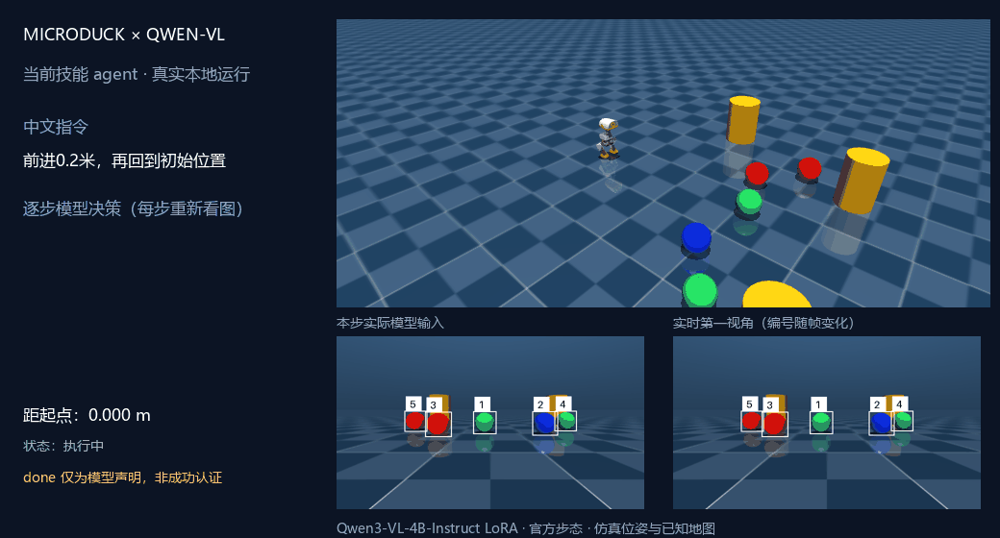
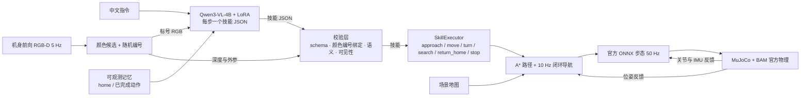
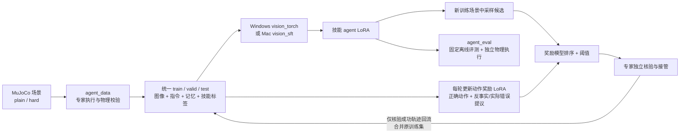

# MicroDuck × Qwen-VL：中文视觉导航（技能 agent）

**VLM 看图 + 中文指令 → 每一步输出一个有界技能 JSON → 校验 → 执行 → 重新观察。** 模型只负责「看图 + 理解指令 + 选技能」，路径、避障与步态由几何规划与官方冻结策略完成。

> 这是本项目**唯一**的 VLM 数据链路。早期纯文本 Qwen 分支（无图像）与只做选球的视觉指代分支都已移除；选球能力并入 `approach` 技能。
> **Windows（PyTorch + CUDA）与 Mac（MLX）两套部署都保留。**



**当前 4B 实录（2026-10-19）。** 输入「前进0.2米，再回到初始位置」，模型依次输出 `move → return_home → done`，实际前进约 0.199 m，最终距起点约 0.053 m；移动与回家技能均通过自身验收。演示使用新训的 `agent-4b-v1-r0`，约 20 秒，包含同色多球与障碍柱，全程没有教师接管。左下为每步实际模型输入，右下为实时第一视角。原始动作、执行结果及 GIF 哈希见 [演示记录](assets/agent-demo.json)。机器人位姿、相机外参与安全地图仍为仿真真值；这条固定演示不代表开放指令可靠性，`done` 仍仅是模型声明。

在已安装模型、仿真依赖和本地技能权重的 Windows 环境中重新录制（覆盖上述 GIF 与记录）：

```powershell
.venv/Scripts/python.exe -X utf8 -m microduck_qwen.record_demo --adapter adapters/agent-4b-v1-r0
```

录制器自建隔离仿真与临时控制端口，真实运行当前 `agent.run_instruction`；权重和上游资源不随 Git 仓库分发。旧的选球导航 GIF 保留在 `assets/vision-navigation-demo.gif`，不代表当前多步 agent 的效果。

## 系统构成



## 当前状态

已实现：

- **逐步技能 agent**：前进/后退、左右转向、接近当前图像里的球、搜索、返回起点、停止、完成、澄清、拒绝未实现功能；每步重新观察，最多 5 步（[AGENT_TRAINING.md](AGENT_TRAINING.md)）。
- **双后端**：Windows 用 PyTorch + CUDA 的 NF4 QLoRA；Mac 用 MLX 4-bit 浮点 LoRA。两者共用同一份 `agent_data` 数据与技能 schema，权重不互换。
- **奖励辅助的专家纠错闭环**：Windows `agent_cycle` 每轮训练 actor 与动作奖励模型，再用奖励排序下一轮提议；专家独立核验，实际错误提议回流为奖励负例。
- **停车后主动提问**：`agent chat` 在移动前发现已知地图路径受阻、视觉目标绑定失败或模型请求澄清时询问用户。支持重试、补充条件、`改为…` 和取消；重试仍须通过新一轮检查。详见 [交互说明](AGENT_TRAINING.md#受阻与澄清时向用户提问)。

尚未实现：无限制自主探索、高层在线 RL、真机验证。不把安全规则当成模型学会的能力。

## 统一的数据回路

当前统一的是 **技能 agent 的数据格式、提示词、动作 schema 与执行器**：`agent_data` 生成 `simulation_agent_v1` 数据，`agent_cycle` 在 Windows 调用 `vision_torch --task agent`、在 Mac 调用 `vision_sft`，两者消费同样的编号 RGB、中文指令、可观测记忆和下一步技能标签。两套后端的适配器权重不互换。



`agent_cycle` 最多运行三轮；纠错只增加训练场景，原验证／测试数据保持固定，失败轨迹保留供诊断但不作为成功示范训练。模型输入不包含教师任务 DSL、目标真值坐标或分割 ID；这些真值只用于标签与验收。物理评估中教师只评分，不代替模型做决策。

**Windows 奖励回路已接入自动迭代。** 每轮 actor SFT 后训练／续训动作奖励模型，并在固定 valid 上独立评测。下一轮纠错采样 1–5 个动作（默认 3），去重、奖励排序；最高分不足预定阈值（默认 0.5）或动作不符合教师目标时，由专家接管。核验成功轨迹成为 actor 训练数据；其中被奖励接受、且通过专家与物理核验的动作额外回放一次，固定 actor 更新步数。实际错误提议与反事实错误动作成为下一轮奖励负例。奖励输入含动作历史，防止把多步任务中的提前 `done` 当成正确完成。

奖励模型不决定真值标签，不绕过物理验收；该流程是有预算的奖励辅助专家数据聚合，仍非完整 UI-Genie、自主在线 RL 或效果已证实的算法。Mac 保留原专家纠错流程；启用奖励迭代目前需要 Windows CUDA。旧奖励适配器没有记忆输入版本，须重新训练。交互 `agent run/chat` 日志仍不自动回流。命令及验证记录见 [AGENT_TRAINING.md](AGENT_TRAINING.md#奖励辅助自动迭代windows)。

历史 2B 模型已完成两轮小预算接入验证及最终回放补测，当时 64 项测试通过。两轮 actor valid 为 16/19、13/19，独立物理任务为 1/4、0/4；没有选出部署权重，也没有证明奖励回路提高任务成功率。最终回放补测确认 8 条经核验奖励样本实际进入额外采样，详见 [审计记录](experiments/reward-loop-v1/summary.json)。

## 模型选型

**统一使用 `Qwen/Qwen3-VL-4B-Instruct`**（Windows CUDA 固定 revision `ebb281ec70b05090aa6165b016eac8ec08e71b17`；Mac MLX 使用 `mlx-community/Qwen3-VL-4B-Instruct-4bit`，固定 revision `2fd8dacbdb8f1e54b8c005f081ec5bf79c56376b`）。

模型下载、技能推理、actor 训练、动作奖励模型及自动迭代均采用 4B。旧 2B actor／奖励适配器与 4B 不兼容，会在校验时拒绝；请从 4B 基座重新训练，不传旧适配器做 resume。既有仿真图文数据可复用。历史实验仍标明原来的 2B 模型；顶部 GIF 已用当前 4B 实际重录。

- RTX 3060 8 GiB（`torch.cuda.mem_get_info()` 实测空闲 7.01 GiB，注意 `nvidia-smi` 的占用口径含桌面程序）逐档实测 NF4 + QLoRA：

  | 模型 | 加载峰值 | 加载后空闲 | 单次决策 | QLoRA 训练峰值 | 秒/步 | 结论 |
  |---|---|---|---|---|---|---|
  | Qwen3-VL-2B-Instruct | 1.4 GiB | ~5.6 GiB | 2.4 s | 2.52 GiB | 0.66 | 历史基线 |
  | Qwen3-VL-4B-Instruct | 2.73 GiB | 4.23 GiB | 1.15–2.44 s | **3.62 GiB（余 2.74 GiB）** | 1.78 | **当前使用** |
  | Qwen3-VL-8B-Instruct | 5.99 GiB | **0.04 GiB** | 7.3–22.3 s | **9.28 GiB → 超出物理显存** | 3.0 | 训练直接爆显存，推理挤到换页 |

  在已短测的配置中选择 **4B**；该次短测训练后剩余约 2.74 GiB。8B 训练约需 9.3 GiB，超过该次 7.01 GiB 可用显存，会使用共享显存。这些容量短测不是正式训练收敛或任务可靠性指标。Mac 使用统一内存，容量限制不同，切换后的 Mac 运行尚未在本机验证。
- 模型 ID 为代码常量（`vision_torch.py` / `vision.py` 的 `MODEL`/`REVISION`），换模型只需改常量；`checked_adapter` 会按 model+revision 拒绝旧适配器。

## Windows / NVIDIA 部署

需要 Python 3.12 与匹配驱动的 CUDA wheel（本次 CUDA 12.8）：

```powershell
python -m venv .venv
.venv/Scripts/python.exe -m pip install torch==2.11.0 torchvision==0.26.0 --index-url https://download.pytorch.org/whl/cu128
.venv/Scripts/python.exe -m pip install -e '.[vision-torch,simulation]'
.venv/Scripts/python.exe -X utf8 -m microduck_qwen.vision download
.venv/Scripts/python.exe -m unittest discover -s tests -v
```

技能控制需要另一终端常驻仿真（命令与真机自检见 [AGENT_TRAINING.md](AGENT_TRAINING.md)）：

```powershell
# 终端一：第一视角相机与 MuJoCo 可视化
.venv/Scripts/python.exe -X utf8 -m microduck_qwen.sim_native --vision --viewer --seed 230000 --port 7846 --manifest runs/vision-simulator.json

# 终端二：加载技能 agent 权重，输入「前进0.2米，再回到初始位置」
.venv/Scripts/python.exe -X utf8 -m microduck_qwen.agent chat --adapter adapters/agent-4b-v1-r0
```

更难的可选场景（只改场景，不动技能与执行层）：`--occlusion partial|full|absent` 让最左侧目标被柱体部分遮挡／完全遮挡／缺失；`--clutter` 生成 5 个球（其中两对同色，必须靠编号而非颜色区分）并加两根柱体。两者可叠加，例如 `--clutter --occlusion full`。采集/训练/评测也支持同一档位：`agent_data`、`agent_eval --rollout`、`agent_cycle` 都有 `--scene-mix {plain,hard}`，详见 [AGENT_TRAINING.md](AGENT_TRAINING.md)。

## macOS / Apple Silicon 部署

Mac 使用 MLX-VLM 4-bit 基座 + 浮点 LoRA：

```bash
uv venv --python 3.12 .venv-vlm
uv pip install --python .venv-vlm/bin/python -r requirements-vision.txt
.venv-vlm/bin/python -m microduck_qwen.vision download
.venv-vlm/bin/python -m unittest discover -s tests -v
```

仿真与控制见 [AGENT_TRAINING.md](AGENT_TRAINING.md)。

## 实测结果

**当前 4B Windows（2026-10-19）**：在既有 `agent-hard-v3` 有限模板数据上从 4B 基座新训 actor 300 步、动作奖励 50 步。固定 valid 动作匹配为基座 **8/19 → LoRA 19/19**，同一开发布局上的四项独立物理任务为 **3/4**；接近球后回家任务错误地直接选择回家，未通过自动选型门槛。奖励 valid 为 **45/57**，正例召回 **13/19**、错误候选误接受 **6/38**。72 项测试及 4B 共享基座的 actor／奖励适配器切换检查通过。单布局、小样本结果不代表普遍可靠；没有新增最终测试推理或等算力 2B/4B 对照，见 [4B 记录](experiments/agent-4b-v1/summary.json)。

**历史 2B 技能 agent（Mac，2026-10-15）**：固定验证集动作完全匹配，冻结基线 **1/19**、R0 **12/19**、R1 **18/19**；开发布局 91010 上 4 个物理任务，R0 **0/4**、R1 **4/4**。没有等训练预算的消融，不能单独归因于纠错方法。

**历史 2B Windows 单链路冒烟（RTX 3060，2026-10-19）**：用小样本（1 训练场景）验证了采集 → 技能 SFT → 奖励 → 离线评估 → 物理闭环整条链路可跑；valid 由冻结基座 **3/19** 提升到 150 步 **15/19**。这是管线自检，不是能力结论；完整命令见 [AGENT_TRAINING.md](AGENT_TRAINING.md)。

**历史视觉指代结果（链路已移除，保留可复现记录）**：Windows 独立测试 56 条记录里，冻结基座 33/56、普通 SFT 49/56；提升来自停止/拒绝模板适配，选球 grounding 未改善。详见 [WINDOWS_VISION.md](WINDOWS_VISION.md) 与 [VISION_RESULTS.md](VISION_RESULTS.md)。

## 边界

- 自身位姿、相机外参与全局安全地图仍来自仿真；本版是「视觉 grounding + oracle 定位/地图」的混合系统。
- 目标检测只覆盖本实验的红/蓝/绿 7 厘米球，不是通用物体检测器。
- 语言校验、可见性保护与停止规则是显式规则，只拒绝错误，不能算作模型能力。
- 训练与评测使用仿真数据与有限中文模板，不能替代真实用户表达评测。
- `done` 是模型声明，不等于客观任务成功；`x/4` 是同一布局上的四个任务，不是四个独立布局。

## 官方仿真依赖

将上游依赖放在仓库同级目录：

- `../microduck/target/debug/robotd`（macOS）
- `../microduck_rl/.venv/`（MuJoCo、ONNX Runtime 与官方 body server）
- `../duck-sim-state/policies/current/`（官方 ONNX 策略）

路径可用 `--microduck / --rl / --policies` 指定。Windows/Linux 使用 PyTorch 后端与 `sim_native` 入口，Mac 使用 MLX 后端与 `sim` 入口。

## 后续研究

1. 收集真实中文表达与失败案例，扩大独立测试集。
2. 将仿真真实状态替换为视觉检测与状态估计，评测感知误差下的任务成功率。
3. 引入动态障碍、多目标组合与失败恢复，再用仿真成功信号做高层 RL。

## 目录与迁移

源码在 `microduck_qwen/`，虚拟环境在 `.venv/`（Windows）或 `.venv-vlm/`（Mac），模型缓存放在 `.cache/`，权重在 `adapters/`，数据在 `data/`，运行记录在 `runs/`。这些生成文件不提交到 Git。复制到新机器后应重建虚拟环境，不要复用其他设备的虚拟环境。

原始来源：[Qwen3-VL 模型](https://huggingface.co/Qwen/Qwen3-VL-4B-Instruct)、[MLX-VLM](https://github.com/Blaizzy/mlx-vlm)、[MicroDuck](https://github.com/pollen-robotics/microduck)、[官方仿真](https://github.com/pollen-robotics/microduck_rl)。
