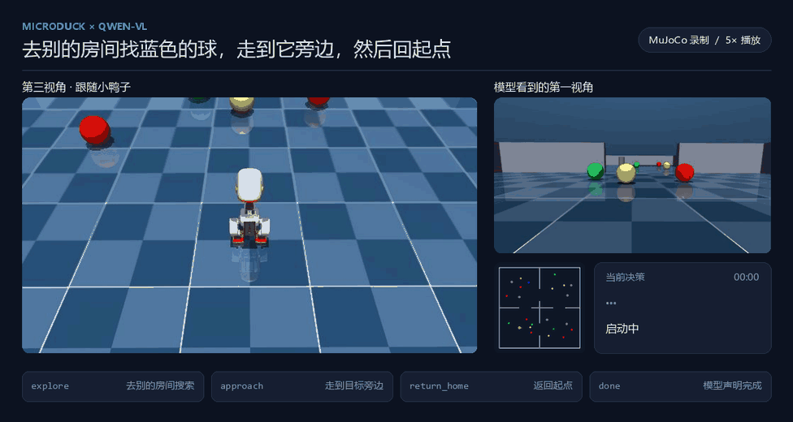
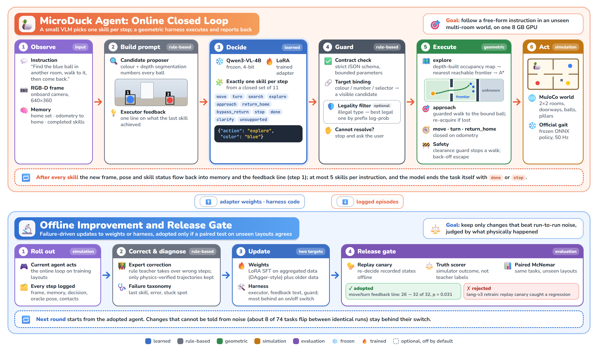

<h1 align="center">
  &nbsp; MicroDuck × Qwen-VL
</h1>

<p align="center"><b>用中文指挥仿真机器人找球、走近并返回起点</b><br>
Qwen3-VL 看图选择下一步技能，MuJoCo 中的规划器和官方步态负责移动。</p>

<p align="center">
  <a href="https://colab.research.google.com/github/atlasmarkz/microduck-qwen/blob/main/notebooks/microduck-qwen-live-demo.ipynb"><b>在 Colab 试 Qwen 演示</b></a>
  &nbsp;·&nbsp;
  <a href="https://colab.research.google.com/github/atlasmarkz/microduck-qwen/blob/main/notebooks/microduck-baseline.ipynb">试原始 MicroDuck</a>
  &nbsp;·&nbsp;
  <a href="https://huggingface.co/atlasmarkz/microduck-skill-agent">公开模型权重</a>
</p>

<p align="center">
  
</p>

一次 MuJoCo 仿真实录，**5× 播放**，实际用时约 115 秒。机器人跨房间找到蓝球，走近后返回起点，最终相距约 **8 cm**。左侧是跟随小鸭子的第三视角，只给观众看；右侧是模型读取的相机图像、俯视轨迹和当前决策。由 `python -m microduck_qwen.record_readme_demo record` 和 `compose` 生成。[逐步记录](assets/microduck-navigation-demo.json) · [早期录像](assets/explore-rooms-4b-v1.gif)

## 在浏览器里试

| 演示 | 你可以做什么 | 环境 |
| --- | --- | --- |
| [官方 MicroDuck](https://colab.research.google.com/github/atlasmarkz/microduck-qwen/blob/main/notebooks/microduck-baseline.ipynb) | 只展示官方内容：原始仓库介绍、33 个 RL 任务的奖励与训练配置、在仿真里实跑 10 个官方策略，以及方向键试驾官方步态的遥控台 | Colab GPU 渲染（没有 GPU 时自动用 CPU），无需模型权重 |
| [MicroDuck × Qwen-VL](https://colab.research.google.com/github/atlasmarkz/microduck-qwen/blob/main/notebooks/microduck-qwen-live-demo.ipynb) | 用自然语言控制机器人：打开就能看 8 个任务、四种控制方式的对照实录；再往下可实时用中文指挥，支持连续对话和中途追问，同屏看第三视角、模型第一视角与轨迹 | 对照实录无需运行；实时控制需 Colab GPU，首次下载约 9 GB |

两份 Notebook 使用同一个 2×2 场景。2026-11-20 在全新的 Colab T4 运行时上从头运行：默认任务连续两轮完成 `explore → approach → return_home → done`，每步模型决策约 1.3–2.1 秒，安装与下载共约 5 分钟。基线版在 Colab CPU 上手动动作 10/10 完成。2026-11-25 在新的 T4 会话上复查两份改版后的 Notebook：默认任务约 2 分钟完成，距起点 8 cm；10 个官方策略全部跑通；控制台在屏幕内约每秒刷新 6–7 次（3 路轮询时测得）。第 1 格会打印 OpenGL 渲染器，GPU 运行时应显示 `Tesla T4` 等显卡名，显示 `llvmpipe` 说明退回了软件渲染。会议演示前，先跑完预热，再执行一轮默认任务。

## 系统如何工作

<p align="center">
  
</p>

1. **看图选技能**：Qwen3-VL-4B + LoRA 根据相机图像、中文指令和动作历史，输出一个技能 JSON。
2. **规划并移动**：执行器用深度图建图，再用前沿探索、A* 路径和官方 ONNX 步态控制机器人。净空不足时停车。
3. **重新观察**：每一步结束后重新取图。训练时用专家纠正错误，只有通过物理验证的轨迹进入训练数据。[训练说明](docs/AGENT_TRAINING.md)

图示源文件和论文版分别见 [架构图源文件](assets/paper/architecture_overview.html) 和 [TikZ](assets/paper/architecture_acl.tex)。

## 实验结果

在两组种子的 2×2 房间仿真中，对 80 个留出任务进行独立执行评测。

| 配置 | 全部任务 | 跨房间找球 |
| --- | ---: | ---: |
| 改进前 | 52/80（65%） | 20/48 |
| 改进后 | **69/80（86%）** | **41/48（85%）** |

提升主要来自建图与导航执行层。整体提升经 McNemar 成对检验（`p=0.002`），样本不足以区分后续的小幅变化。位姿与安全真值来自仿真，尚无真机验证。`done` 是模型对任务状态的判断，实验成功与否由执行评测判定。[实验记录](experiments/lang-v1/summary.md) · [相关研究](docs/related-work.md)

### 控制框架与 LoRA 的作用

另一组 80 个任务来自 16 个全新布局，按仿真状态检查是否到达目标、返回起点及发生碰撞。每组都让模型自己跑到结束，并记录完整位姿（`scripts/pipelines/eval-free-run.sh`，2026-11-25）。

| 控制配置 | 按仿真状态评分 | 走近并返回 | 定距移动 | 跨房间找球 |
| --- | ---: | ---: | ---: | ---: |
| 冻结 Qwen3-VL-4B，只能输出基本动作 | 0/80 | 0/16 | 0/16 | 0/48 |
| 同一冻结模型 + 技能、建图导航与校验 | 25/80 | 0/16 | 0/16 | 25/48 |
| 同一框架 + 结束规则，无额外训练 | **77/80** | 16/16 | 16/16 | 45/48 |
| 同一框架 + LoRA（`lang-v2`） | 73/80 | 16/16 | 16/16 | 41/48 |

- **框架**：从 0 到 25。只有基本动作时，跨房间找球为 0/48，即使事后替模型选择结束时刻也没有改善，机器人离目标最近时的中位距离仍为 3.4 m。无框架时，首轮 2661 次决策中没有一次输出停止，45% 的前进请求因不安全被拒绝。这个实验的「只输出基本动作」仍在用 Qwen，和上面的手动 Colab 是两个对照。
- **结束规则**：25 → 77。冻结模型常常不给出结束判断，有 30 题用完 5 步仍未结束任务，走近返回和定距移动因此全部失败。两行规则（只在确认返回后允许 `done`，不重复同一移动）补上了这一点。
- **LoRA 与结束规则**：逐题比较，只有规则成功的 5 题，只有 LoRA 成功的 1 题，差别不显著（McNemar `p=0.22`）。LoRA 的 7 次失败中，5 次是执行器因净空不足停车，2 次是对英文指令反问。在这组任务上，LoRA 带来的提升可以由结束规则替代。但规则是看过同一批种子的失败后写的，尚未用新种子验证。

此前的评测在模型第一次偏离参考动作时截断，当时记为 27、68、74。不截断后，冻结模型被截断的 49 题中只有 1 题成功。[详细比较](docs/improvement-evidence.md) · [实验记录](experiments/lang-v1/summary.md)

## 本地复现

Windows 需要 Python 3.12 和匹配的 NVIDIA CUDA 驱动。准备好官方仿真资产，并从模型仓库下载 `lang-v2` 目录至 `adapters/lang-v2`。[本地环境与资产说明](docs/AGENT_TRAINING.md) · [权重下载](https://huggingface.co/atlasmarkz/microduck-skill-agent/tree/main/lang-v2)

```powershell
python -m venv .venv
.venv/Scripts/python.exe -m pip install torch==2.11.0 torchvision==0.26.0 --index-url https://download.pytorch.org/whl/cu128
.venv/Scripts/python.exe -m pip install -e '.[vision-torch,simulation]'
.venv/Scripts/python.exe -X utf8 -m microduck_qwen.vision download
.venv/Scripts/python.exe -m unittest discover -s tests -v
```

```bash
# 录制默认场景（seed 98107）
bash scripts/record_demo_world.sh adapters/lang-v2 98107

# 复现 80 个留出任务的评测（需准备 data/lang-v2）
bash scripts/eval_world.sh adapters/lang-v2 data/lang-v2 eval
```

[源码](microduck_qwen/) · [Colab Notebook](notebooks/) · [评测与训练脚本](scripts/) · [实验记录](experiments/) · [许可证](LICENSE) · [第三方来源](THIRD_PARTY_NOTICES.md)
