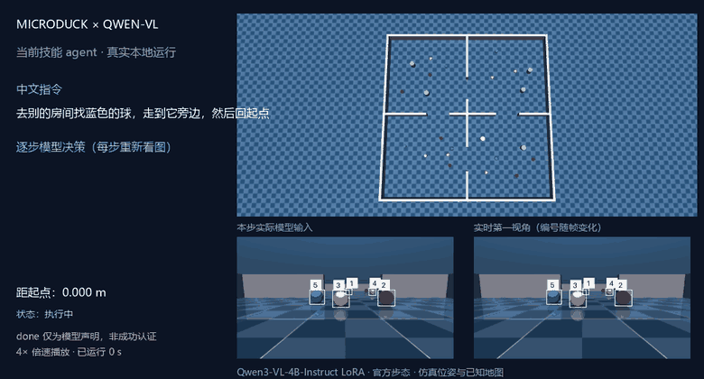
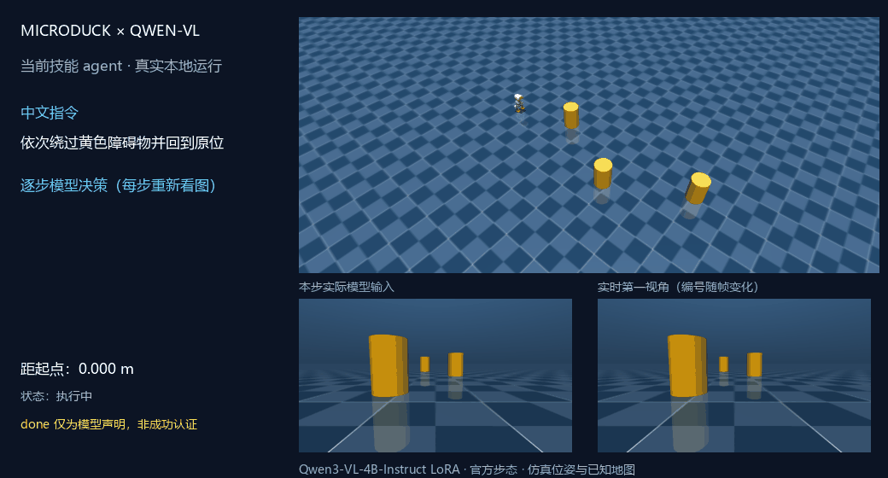
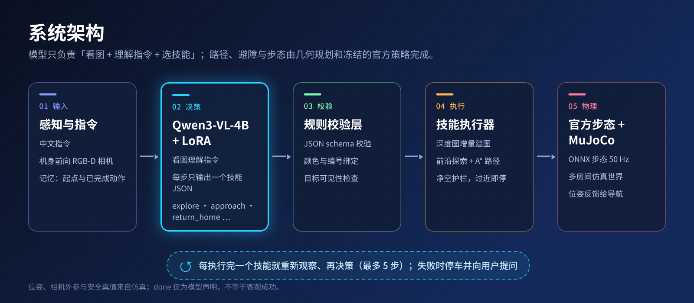
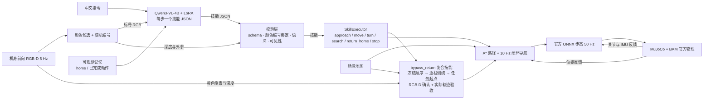
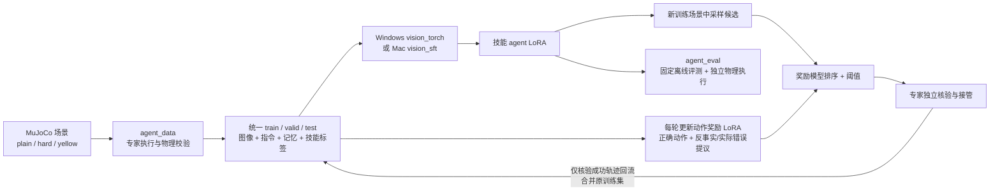

# MicroDuck × Qwen-VL：中文视觉导航（技能 agent）

**VLM 看图 + 中文指令 → 每一步输出一个有界技能 JSON → 校验 → 执行 → 重新观察。** 模型只负责「看图 + 理解指令 + 选技能」，路径、避障与步态由几何规划与官方冻结策略完成。

> 这是本项目**唯一**的 VLM 数据链路。早期纯文本 Qwen 分支（无图像）与只做选球的视觉指代分支都已移除；选球能力并入 `approach` 技能。
> **Windows（PyTorch + CUDA）与 Mac（MLX）两套部署都保留。**



**多房间探索实录（2026-11-04）。** 输入「去别的房间找蓝色的球，走到它旁边，然后回起点」，`lang-v2` 权重输出 `explore / blue → approach / blue / nearest → return_home → done`：先用深度图增量建图并朝最近的可达前沿探索，看到蓝球后走近，再返回起点，最终距起点约 **0.079 m**。种子 98107，真实运行当前 `agent.run_instruction`，全程没有教师接管；GIF 为 **4 倍速**（画面已标注），原始运行约 125 秒。这是一次成功的单次运行，不是成功率：该世界等级下留出评测的找球任务为 41/48（见下文）；`done` 仍只是模型声明。位姿、相机外参与安全真值仍来自仿真。为控制体积，GIF 重新编码为 780×420、隔帧保留，原始动作与哈希见 [记录](assets/explore-rooms-4b-v1.json)。重录命令：

```powershell
.venv/Scripts/python.exe -X utf8 -m microduck_qwen.record_demo --adapter adapters/lang-v2 --world --world-seed 98107
```



**当前复杂任务 4B 实录（2026-10-19）。** 输入「依次绕过黄色障碍物并回到原位」，模型输出 `bypass_return / auto → done`；执行器按近到远经过三根黄柱后方，再回到本条任务起点。实际轨迹通过侧向穿越与顺序验收，最终距任务起点约 **0.095 m**、朝向误差 **8.22°**。演示使用续训 120 步的 `agent-yellow-v1`，约 81 秒，全程没有教师接管，保留真实时间。左下为实际模型输入，右下为实时第一视角；六个绕行路点与返程由几何执行器控制，VLM 共做两次技能决策。原始动作、结果及 GIF 哈希见 [演示记录](assets/yellow-obstacles-4b-v1.json)。位姿、相机外参与静态地图仍为仿真真值；`done` 仅是模型声明，新权重有旧任务退化，尚未替换通用默认权重。

在已安装模型、仿真依赖和本地技能权重的 Windows 环境中重新录制（覆盖上述 GIF 与记录）：

```powershell
.venv/Scripts/python.exe -X utf8 -m microduck_qwen.record_demo --adapter adapters/agent-yellow-v1 --yellow-course
```

录制器自建隔离仿真与临时控制端口，真实运行当前 `agent.run_instruction`；权重和上游资源不随 Git 仓库分发。旧的选球导航 GIF 保留在 `assets/vision-navigation-demo.gif`，不代表当前多步 agent 的效果。

## 系统构成

完整分层架构图（Figma 源文件：[MicroDuck Qwen Architecture](https://www.figma.com/design/6TgbBmgfgOc52QLZvH5eTN)）：





## 当前状态

### 本机独立物理评测 · 2026-10-31

| 指标 | 结果 | 说明 |
|---|---:|---|
| 任务完整通过 | 3/4 | 单个 hard 场景、四条固定任务，评测器使用严格动作匹配 |
| 障碍接触 | 0/4 次任务 | 以 MuJoCo 场景物体接触记录计数 |
| 错误目标 | 未能得出比例 | 唯一选球任务实际绑定了教师指定的目标，但评测器误判并提前终止 |
| 澄清与失败恢复 | 未测量 | 本次运行关闭交互，未注入需要恢复的失败 |

第四项要求「接近最左侧的球，然后返回」：模型输出 `selector=leftmost`，执行时绑定的球编号 4 与教师目标编号 4 一致，接近成功。但评测器按 JSON 完全相等比较，教师使用 `id=4`，因此提前判错并未执行返程。**3/4 是原始评测器结果，第四项完整任务成功与否未知。** 这是单布局的小样本开发评估，不是通用成功率。[逐任务证据与复现命令](experiments/local-review-20261031/README.md)。

目前主要问题是：评测器把等价动作误判为错误；自然语言组合任务和失败恢复缺少足够的独立场景；安全规划依赖仿真真值位姿与已知静态地图，不能直接代表未知动态环境或真机效果。奖励辅助纠错尚未在当前 4B 上完成多轮效果对照。

已实现：

- **逐步技能 agent**：前进/后退、左右转向、接近当前图像里的球、搜索、返回起点、停止、完成、澄清、拒绝未实现功能；每步重新观察，最多 5 步（[AGENT_TRAINING.md](AGENT_TRAINING.md)）。
- **顺序绕障并返回**：`bypass_return` 支持 1–3 个已知黄色障碍，按任务开始时由近到远的顺序，从侧面到后方，最后返回本条任务起点并恢复朝向；RGB-D 先确认目标，几何执行器检查实测轨迹。
- **双后端**：Windows 用 PyTorch + CUDA 的 NF4 QLoRA；Mac 用 MLX 4-bit 浮点 LoRA。两者共用同一份 `agent_data` 数据与技能 schema，权重不互换。
- **奖励辅助的专家纠错闭环**：Windows `agent_cycle` 每轮训练 actor 与动作奖励模型，再用奖励排序下一轮提议；专家独立核验，实际错误提议回流为奖励负例。
- **停车后主动提问**：`agent chat` 在移动前发现已知地图路径受阻、视觉目标绑定失败或模型请求澄清时询问用户。支持重试、补充条件、`改为…` 和取消；重试仍须通过新一轮检查。详见 [交互说明](AGENT_TRAINING.md#受阻与澄清时向用户提问)。

- **多房间世界与探索**（2026-11）：`--world ROWS COLS` 生成带墙和门洞的大场景（[vision_world.py](microduck_qwen/vision_world.py)），`explore` 技能用深度图增量建图，朝最近的可达前沿走，直到看到指定颜色的球。真实仿真中，自由说法的指令「去别的房间找蓝色的球，走到它旁边，然后回起点」被正确执行（零碰撞）。位姿仍是仿真真值；仅为单布局小样本，见 [记录](experiments/self-evolve-v1/summary.md)。
- **自进化闭环**（[self_evolve.py](microduck_qwen/self_evolve.py)）：自由探索 → 自己出题 → 自己尝试 → 用感知、里程计和碰撞传感器自验证 → 只用验证通过的轨迹重训 → 留出世界复测。闭环已跑通；**第一轮没有证明能力提升**（留出 5/6 → 4/6，被门槛拒绝，样本极小），且已知贴障后无法脱困。

### 多房间世界留出评测与探索改进 · 2026-11

在 2×2 房间世界（level 2，门宽 1.1 m，起点房间前有三球一排）上，对同一批 80 个留出任务（种子 98000 / 98100，每组 8 个布局）做独立 actor 滚动评测：每组含「靠近最左球再回起点」「往前移动 20 厘米」和每个首视野看不到的颜色各 3 条「去别处找某色球并走到旁边」。

| 版本 | 总成功 | 探索找球任务 | 说明 |
|---|---:|---:|---|
| lang-v1，改进前 | 52/80 (65%) | 20/48 | 基线 |
| + return_home 重试、目标记忆、安全停车后继续 | 61/80 | 29/48 | 执行层小修 |
| + 忠实建图（无回波射线不再清出空地） | 64/80 (80%) | 32/48 | 根因：相机高于 0.4 m 墙，越墙射线被当作可通行，造出场外假前沿 |
| lang-v2 权重（纠错数据续训） | 63/80 | 32/48 | 动作类型错误 6 → 1，但预算耗尽 2 → 7 |
| + 导航余量下限与四档净空 | **69/80 (86%)** | **41/48 (85%)** | 预算耗尽 7 → 0，平均探索 117 s |

要点与限制：

- 提升主要来自**执行层**（建图、净空档位、重试），不是重训；「无可达前沿」失败从 11 降到 0。
- 相同配置两次运行的波动约 ±4 / 40，所以 69 对 63–64 的差距超出噪声，但仍只是单一世界等级、两组种子、仿真环境。
- 已知弱点：`lang-v2` 下「往前移动 20 厘米」走完后有 4/16 输出 `unsupported` 而非 `done`（推测是纠错数据副作用，正在用针对性数据修复）；最窄门口的布局（98101）仍有 4 次因净空护栏停下。
- 位姿、外参与安全真值仍来自仿真；没有真机验证。逐步记录见 [experiments/lang-v1/summary.md](experiments/lang-v1/summary.md)，新增诊断脚本 `diag_explore.py`、`render_map.py`、`diag_stop.py`。

尚未实现：高层在线 RL、未知环境下的安全保证、真机验证。不把安全规则当成模型学会的能力。

## 统一的数据回路

当前统一的是 **技能 agent 的数据格式、提示词、动作 schema 与执行器**：`agent_data` 生成 `simulation_agent_v1` 数据，`agent_cycle` 在 Windows 调用 `vision_torch --task agent`、在 Mac 调用 `vision_sft`，两者消费同样的编号 RGB、中文指令、可观测记忆和下一步技能标签。两套后端的适配器权重不互换。



`agent_cycle` 最多运行三轮；纠错只增加训练场景，原验证／测试数据保持固定，失败轨迹保留供诊断但不作为成功示范训练。模型输入不包含教师任务 DSL、目标真值坐标或分割 ID；这些真值只用于标签与验收。物理评估中教师只评分，不代替模型做决策。

**Windows 奖励回路已接入自动迭代。** 每轮 actor SFT 后训练／续训动作奖励模型，并在固定 valid 上独立评测。下一轮纠错采样 1–5 个动作（默认 3），去重、奖励排序；最高分不足预定阈值（默认 0.5）或动作不符合教师目标时，由专家接管。核验成功轨迹成为 actor 训练数据；其中被奖励接受、且通过专家与物理核验的动作额外回放一次，固定 actor 更新步数。实际错误提议与反事实错误动作成为下一轮奖励负例。奖励输入含动作历史，防止把多步任务中的提前 `done` 当成正确完成。

奖励模型不决定真值标签，不绕过物理验收；该流程是有预算的奖励辅助专家数据聚合，仍非完整 UI-Genie、自主在线 RL 或效果已证实的算法。Mac 保留原专家纠错流程；启用奖励迭代目前需要 Windows CUDA。旧奖励适配器没有记忆输入版本，须重新训练。交互 `agent run/chat` 日志仍不自动回流。命令及验证记录见 [AGENT_TRAINING.md](AGENT_TRAINING.md#奖励辅助自动迭代windows)。

历史 2B 模型已完成两轮小预算接入验证及最终回放补测，当时 64 项测试通过。两轮 actor valid 为 16/19、13/19，独立物理任务为 1/4、0/4；没有选出部署权重，也没有证明奖励回路提高任务成功率。最终回放补测确认 8 条经核验奖励样本实际进入额外采样，详见 [审计记录](experiments/reward-loop-v1/summary.json)。

## 模型选型

**统一使用 `Qwen/Qwen3-VL-4B-Instruct`**（Windows CUDA 固定 revision `ebb281ec70b05090aa6165b016eac8ec08e71b17`；Mac MLX 使用 `mlx-community/Qwen3-VL-4B-Instruct-4bit`，固定 revision `2fd8dacbdb8f1e54b8c005f081ec5bf79c56376b`）。

模型下载、技能推理、actor 训练、动作奖励模型及自动迭代均采用 4B。旧 2B actor／奖励适配器与 4B 不兼容，会在校验时拒绝；请从 4B 基座重新训练，不传旧适配器做 resume。既有仿真图文数据可复用。历史实验仍标明原来的 2B 模型；顶部 GIF 已用当前 4B 实际重录。

- RTX 3060 8 GiB（`torch.cuda.mem_get_info()` 实测空闲 7.01 GiB，注意 `nvidia-smi` 的占用口径含桌面程序）逐档实测 NF4 + QLoRA：

  | 模型 | 加载峰值 | 加载后空闲 | 单次决策 | QLoRA 训练峰值 | 秒/步 | 结论 |
  |---|---|---|---|---|---|---|
  | Qwen3-VL-2B-Instruct | 1.4 GiB | ~5.6 GiB | 2.4 s | 2.52 GiB | 0.66 | 历史基线 |
  | Qwen3-VL-4B-Instruct | 2.73 GiB | 4.23 GiB | 1.15–2.44 s | **3.62 GiB（余 2.74 GiB）** | 1.78 | **当前使用** |
  | Qwen3-VL-8B-Instruct | 5.99 GiB | **0.04 GiB** | 7.3–22.3 s | **9.28 GiB → 超出物理显存** | 3.0 | 训练直接爆显存，推理挤到换页 |

  在已短测的配置中选择 **4B**；该次短测训练后剩余约 2.74 GiB。8B 训练约需 9.3 GiB，超过该次 7.01 GiB 可用显存，会使用共享显存。这些容量短测不是正式训练收敛或任务可靠性指标。Mac 使用统一内存，容量限制不同，切换后的 Mac 运行尚未在本机验证。
- 模型 ID 为代码常量（`vision_torch.py` / `vision.py` 的 `MODEL`/`REVISION`），换模型只需改常量；`checked_adapter` 会按 model+revision 拒绝旧适配器。

## Windows / NVIDIA 部署

需要 Python 3.12 与匹配驱动的 CUDA wheel（本次 CUDA 12.8）：

```powershell
python -m venv .venv
.venv/Scripts/python.exe -m pip install torch==2.11.0 torchvision==0.26.0 --index-url https://download.pytorch.org/whl/cu128
.venv/Scripts/python.exe -m pip install -e '.[vision-torch,simulation]'
.venv/Scripts/python.exe -X utf8 -m microduck_qwen.vision download
.venv/Scripts/python.exe -m unittest discover -s tests -v
```

技能控制需要另一终端常驻仿真（命令与真机自检见 [AGENT_TRAINING.md](AGENT_TRAINING.md)）：

```powershell
# 终端一：第一视角相机与 MuJoCo 可视化
.venv/Scripts/python.exe -X utf8 -m microduck_qwen.sim_native --vision --viewer --seed 230000 --port 7846 --manifest runs/vision-simulator.json

# 终端二：加载技能 agent 权重，输入「前进0.2米，再回到初始位置」
.venv/Scripts/python.exe -X utf8 -m microduck_qwen.agent chat --adapter adapters/agent-4b-v1-r0
```

更难的可选场景（只改场景，不动技能与执行层）：`--occlusion partial|full|absent` 让最左侧目标被柱体部分遮挡／完全遮挡／缺失；`--clutter` 生成 5 个球（其中两对同色，必须靠编号而非颜色区分）并加两根柱体。两者可叠加，例如 `--clutter --occlusion full`。采集/训练/评测也支持同一档位：`agent_data`、`agent_eval --rollout`、`agent_cycle` 都有 `--scene-mix {plain,hard}`，详见 [AGENT_TRAINING.md](AGENT_TRAINING.md)。

## 复杂任务：依次绕过黄色障碍物并回到原位

在两个终端分别运行：

```powershell
.venv/Scripts/python.exe -X utf8 -m microduck_qwen.sim_native --vision --viewer --yellow-course --seed 92001 --port 7846 --manifest runs/vision-simulator.json
```

```powershell
.venv/Scripts/python.exe -X utf8 -m microduck_qwen.agent run '依次绕过黄色障碍物并回到原位' --adapter adapters/agent-yellow-v1 --interactive
```

本地实验权重需先按 [训练说明](AGENT_TRAINING.md#黄色障碍复合任务) 生成，不随仓库分发。偶数 seed 为两根柱、奇数为三根柱，坐标有随机扰动；本场景不与 `--clutter/--occlusion` 混用。

这里的“绕过”按已确认的验收方式执行：**从每根柱的一侧走到后方，再前往下一根，最后返回任务起点**；不是绕柱一整圈。未指定方向用 `side=auto` 根据已知地图选择较短的可行侧，也可明确说“从左侧／右侧”。顺序和前后方向在任务开始时冻结；“原位”是本条指令开始的位置与朝向，`return_home` 则仍指仿真启动位置。

Qwen3-VL-4B 看图理解指令并选择复合技能；RGB-D 黄色连通区域和深度用于初始目标确认，柱体坐标与避障几何来自已知仿真地图。逐柱执行和返回由确定性控制完成，不依赖 VLM 每个路点都重新规划。只支持有界静态场景，尚无未知环境视觉建图或动态障碍绕行；预检查失败时停车询问，部分运动后失败则停止。

本轮新增任务 valid/test 均 **2/2**，两柱／三柱独立物理执行 **2/2**，均无教师接管或障碍接触。混合旧任务后 valid 为 **19/21**、最终 test 为 **16/18**，因此保留实验权重身份；78 项测试通过。数据、训练、原始模型输出及实际轨迹见 [实验记录](experiments/yellow-course-v1/summary.json)。

**接近黄柱后停下**也已接入：在上述场景启动 `agent chat --adapter adapters/agent-yellow-v1`，输入「走到黄色的柱子旁边停下」；有多根可见黄柱时先停车询问，补充「最近的一根」后再行动。也可直接输入「走到离我最近的黄色柱子旁边停下」。柱子由 RGB-D 生成带编号的视觉目标；`approach` 使用 `selector=nearest/leftmost/rightmost/only` 绑定，不允许模型猜柱子编号。名义停靠距柱心 0.45 m，执行中检查目标可见性；这与绕障并返回是两个不同任务。修复验证见 [黄柱接近记录](experiments/pillar-approach-v1/summary.json)。

该接近修复复用原权重，无额外训练；实跑经一次澄清后停在真实最近柱心 0.459 m 处，无障碍接触。81 项测试通过，修复后的固定开发集回归为 20/21。仍是有限颜色、已知尺寸物体和有界技能的原型，不能将某条绕障演示当作任意自然语言的泛化能力。训练模板不足和模型误选／重复动作仍是实际限制。

## macOS / Apple Silicon 部署

Mac 使用 MLX-VLM 4-bit 基座 + 浮点 LoRA：

```bash
uv venv --python 3.12 .venv-vlm
uv pip install --python .venv-vlm/bin/python -r requirements-vision.txt
.venv-vlm/bin/python -m microduck_qwen.vision download
.venv-vlm/bin/python -m unittest discover -s tests -v
```

仿真与控制见 [AGENT_TRAINING.md](AGENT_TRAINING.md)。

## 实测结果

**当前 4B Windows（2026-10-19）**：在既有 `agent-hard-v3` 有限模板数据上从 4B 基座新训 actor 300 步、动作奖励 50 步。固定 valid 动作匹配为基座 **8/19 → LoRA 19/19**，同一开发布局上的四项独立物理任务为 **3/4**；接近球后回家任务错误地直接选择回家，未通过自动选型门槛。奖励 valid 为 **45/57**，正例召回 **13/19**、错误候选误接受 **6/38**。72 项测试及 4B 共享基座的 actor／奖励适配器切换检查通过。单布局、小样本结果不代表普遍可靠；没有新增最终测试推理或等算力 2B/4B 对照，见 [4B 记录](experiments/agent-4b-v1/summary.json)。

**历史 2B 技能 agent（Mac，2026-10-15）**：固定验证集动作完全匹配，冻结基线 **1/19**、R0 **12/19**、R1 **18/19**；开发布局 91010 上 4 个物理任务，R0 **0/4**、R1 **4/4**。没有等训练预算的消融，不能单独归因于纠错方法。

**历史 2B Windows 单链路冒烟（RTX 3060，2026-10-19）**：用小样本（1 训练场景）验证了采集 → 技能 SFT → 奖励 → 离线评估 → 物理闭环整条链路可跑；valid 由冻结基座 **3/19** 提升到 150 步 **15/19**。这是管线自检，不是能力结论；完整命令见 [AGENT_TRAINING.md](AGENT_TRAINING.md)。

**历史视觉指代结果（链路已移除，保留可复现记录）**：Windows 独立测试 56 条记录里，冻结基座 33/56、普通 SFT 49/56；提升来自停止/拒绝模板适配，选球 grounding 未改善。详见 [WINDOWS_VISION.md](WINDOWS_VISION.md) 与 [VISION_RESULTS.md](VISION_RESULTS.md)。

## 边界

- 自身位姿、相机外参与全局安全地图仍来自仿真；本版是「视觉 grounding + oracle 定位/地图」的混合系统。
- 目标检测只覆盖本实验的红/蓝/绿 7 厘米球，不是通用物体检测器。
- 语言校验、可见性保护与停止规则是显式规则，只拒绝错误，不能算作模型能力。
- 训练与评测使用仿真数据与有限中文模板，不能替代真实用户表达评测。
- `done` 是模型声明，不等于客观任务成功；`x/4` 是同一布局上的四个任务，不是四个独立布局。

## 官方仿真依赖

将上游依赖放在仓库同级目录：

- `../microduck/target/debug/robotd`（macOS）
- `../microduck_rl/.venv/`（MuJoCo、ONNX Runtime 与官方 body server）
- `../duck-sim-state/policies/current/`（官方 ONNX 策略）

路径可用 `--microduck / --rl / --policies` 指定。Windows/Linux 使用 PyTorch 后端与 `sim_native` 入口，Mac 使用 MLX 后端与 `sim` 入口。

## 后续研究

1. 收集真实中文表达与失败案例，扩大独立测试集。
2. 将仿真真实状态替换为视觉检测与状态估计，评测感知误差下的任务成功率。
3. 引入动态障碍、多目标组合与失败恢复，再用仿真成功信号做高层 RL。

## 目录与迁移

源码在 `microduck_qwen/`，虚拟环境在 `.venv/`（Windows）或 `.venv-vlm/`（Mac），模型缓存放在 `.cache/`，权重在 `adapters/`，数据在 `data/`，运行记录在 `runs/`。这些生成文件不提交到 Git。复制到新机器后应重建虚拟环境，不要复用其他设备的虚拟环境。

原始来源：[Qwen3-VL 模型](https://huggingface.co/Qwen/Qwen3-VL-4B-Instruct)、[MLX-VLM](https://github.com/Blaizzy/mlx-vlm)、[MicroDuck](https://github.com/pollen-robotics/microduck)、[官方仿真](https://github.com/pollen-robotics/microduck_rl)。

## 贡献者 / Contributors

- [Mark Zhang（@atlasmarkz）](https://github.com/atlasmarkz)：项目作者与维护者。
- Codex（OpenAI）：AI 协作贡献者，协助整理项目主题标签与贡献者文档。
