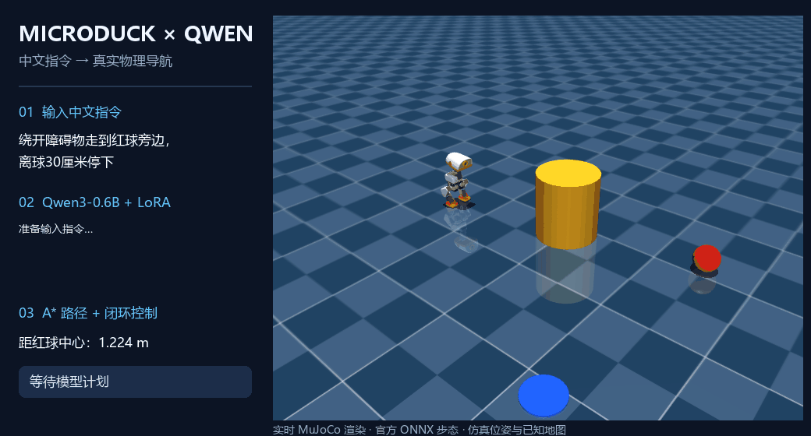
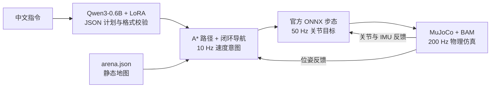

# MicroDuck × Qwen：中文目标导航



**本机实录：中文指令 → Qwen 文本 LoRA → 真实 MuJoCo 导航。** 画面旁的文字为运行状态叠加；当前演示使用仿真位姿和已知地图，尚未接入视觉 Qwen-VL。



文本 LoRA 学习目标、速度和停靠距离；导航器负责路径与停车，官方预训练策略负责步态。GIF 中的运动来自真实物理步进，[录制记录](assets/navigation-demo.json) 保存实际模型输出和执行结果。机器人资产与步态来源为 [Pollen Robotics](https://github.com/pollen-robotics/microduck_rl)，许可证说明见 [第三方声明](THIRD_PARTY_NOTICES.md)。

录制脚本为 `microduck_qwen/record_demo.py`；本机依赖与权重准备完成后可运行 `.venv/Scripts/python.exe -X utf8 -m microduck_qwen.record_demo` 重新录制。

## 项目目标与当前状态

研究目标是后训练 Qwen-VL，使其根据视觉、自然语言和历史反馈产生高层决策，结合 MicroDuck 已有 RL 步态完成仿真控制。已实现文本 SFT、视觉选球 SFT，以及新的**逐步技能 agent、仿真专家采集、专家接管式纠错回流和有预算的迭代 LoRA 流程**。新入口与边界见 [AGENT_TRAINING.md](AGENT_TRAINING.md)，旧视觉实验见 [SIM_TRAINING.md](SIM_TRAINING.md)。学习型 RM、无限制自主探索和高层 RL 尚未实现；不把安全规则当成模型学会的能力。硬件与后续计划见 [TRAINING_PLAN.md](TRAINING_PLAN.md)。

获取源码：

```bash
git clone git@github.com:AMark-CS/microduck-qwen.git
cd microduck-qwen
```

GitHub 只同步源码、依赖配置、测试及说明，不包含本机虚拟环境、模型缓存、LoRA 权重、生成数据或原始运行日志。新机器需要按下面流程创建环境、下载模型并训练；本机“已训练完成”的描述仅指现有本地安装。`data-v1/` 和历史权重未发布，因此历史两阶段训练不能仅凭本仓库完整复现；当前数据生成器可重新生成当前版本的数据。

文本分支新训练示例（模型已下载、数据已生成后）：

```bash
.venv/bin/python -m microduck_qwen.train --iters 300 --adapter adapters/nav-v2
```

这会新建一组适配器，不等同于历史 900 步权重；已有同名权重时训练器会拒绝覆盖。MicroDuck 仿真仓库与策略需另行准备，路径可通过 `sim --microduck PATH --rl PATH --policies PATH` 指定。本机默认路径不是跨机器安装保证。

视觉分支已独立实现：看图选择左右球、随机布局、RGB-D 定位和遮挡保护。默认仍为冻结 Qwen3-VL-2B，可用 `vision chat --adapter PATH` 显式加载本机图文 SFT 权重，见 [VISION.md](VISION.md) 与 [SIM_TRAINING.md](SIM_TRAINING.md)。本页下面的训练与 61.25% 指标仍专指 Qwen3-0.6B 文本 SFT，不是视觉训练结果。

在 Apple Silicon Mac 上对 Qwen3-0.6B 做 LoRA 监督微调，输入中文导航指令，输出目标及速度、停靠距离；导航器使用 MuJoCo 位姿与场景地图规划避障路径，向官方 `robotd` 发送速度命令，既有 ONNX 步态策略在 50 Hz 控制机器人。

这是实际更新 Qwen 适配器参数的 SFT 后训练。原始 Qwen 权重冻结；步态策略保持为官方预训练策略。

## Windows / NVIDIA 文本实验

文本分支在 Windows/Linux 自动使用 PyTorch + PEFT，在 Apple Silicon 上保留 MLX。两种 LoRA 权重格式不同，不能混用。本节只评估中文指令到 JSON 计划的映射，不代表机器人导航成功率。

以下 PowerShell 命令均从仓库根目录执行。需要 Python 3.12；先按 [PyTorch 官方说明](https://pytorch.org/get-started/locally/) 安装匹配驱动的 CUDA wheel。本次使用 CUDA 12.8 wheel：

```powershell
python -m venv .venv
.venv/Scripts/python.exe -m pip install torch==2.11.0 --index-url https://download.pytorch.org/whl/cu128
.venv/Scripts/python.exe -m pip install -e '.[torch]'
.venv/Scripts/python.exe -m pip install opencv-python==5.0.0.93
.venv/Scripts/python.exe -m microduck_qwen.download
.venv/Scripts/python.exe -m microduck_qwen.dataset
.venv/Scripts/python.exe -m unittest discover -s tests -v
.venv/Scripts/python.exe -m microduck_qwen.evaluate --base --limit 80 --output runs/windows-base.json
.venv/Scripts/python.exe -m microduck_qwen.train --iters 300 --adapter adapters/nav-torch
.venv/Scripts/python.exe -m microduck_qwen.evaluate --adapter adapters/nav-torch --limit 80 --output runs/windows-sft.json
.venv/Scripts/python.exe -m microduck_qwen.cli plan '移动到世界坐标（0.2，-0.4）' --adapter adapters/nav-torch
```

OpenCV 用于完整单元测试，不代表视觉模型已在 Windows 上运行。训练使用最后 16 层全部线性层的 rank-16 LoRA（alpha=32）、batch size 2、学习率 1e-4、种子 42、最长 768 tokens，仅对答案和 EOS 计算损失。超过序列上限时报错；已有非空输出目录拒绝覆盖。`adapters/nav-torch/provenance.json` 保存版本、数据哈希、损失、训练时间、显存和参数更新检查。CPU 可运行但较慢；Windows 原生物理仿真和文本控制见下节，视觉训练仍未移植。

### Windows 实测结果（2026-10-15）

Windows、RTX 3060 8 GiB、Python 3.12.14；PyTorch 2.11.0+cu128、Transformers 5.19.0、PEFT 0.21.2。Qwen3-0.6B 固定 revision 为 `c1899de289a04d12100db370d81485cdf75e47ca`。使用当前生成器产生的 1,542 条训练、148 条验证、226 条测试数据；训练预算预先固定为 300 步，原模型与适配器使用随机种子 42 分层抽取的同一批 80 条测试指令；适配器仅在训练完成后评测一次，未根据测试错误调参。

| 指标（同一批 80 条指令） | 原模型 | PyTorch LoRA 300 步 |
| --- | ---: | ---: |
| 完整计划精确匹配 | 16/80（20.0%） | 75/80（93.75%） |
| 合法输出率 | 65/80（81.25%） | 80/80（100%） |
| 单物体目标 | 14/26 | 26/26 |
| 坐标目标 | 0/26 | 26/26 |
| 多目标序列 | 1/20 | 15/20 |
| 停止 / 不支持任务 | 1/3、0/5 | 3/3、5/5 |
| 中位推理延迟 | 2.05 秒 | 3.74 秒 |

训练约 145.8 秒，5,767,168 个可训练参数，224 个 LoRA 张量均发生更新；验证集 completion loss 为 0.0005304。PyTorch 峰值分配显存约 2.20 GiB，此值不含其他应用、驱动和未分配缓存的全部开销。最终 52 项单元测试全部通过，含小型 Qwen 真实训练、保存加载、提示词/填充损失屏蔽和文件锁检查。

剩余五条错误均为多目标序列，主要是第一个目标的停靠距离丢失或串到后一个目标，其中一条还串用了速度。这里只完成单种子、有限合成模板的文本实验，没有 Windows 视觉训练或物理 rollout；不能当作真实用户表达或机器人任务成功率。历史 MLX 实验的后端、LoRA 缩放和训练预算不同，不能将结果差异直接归因于平台。

可审计结果：[实验摘要](experiments/windows-text-v1/summary.json)、[原模型逐条输出](experiments/windows-text-v1/base-test.json)、[LoRA 逐条输出](experiments/windows-text-v1/sft-test.json)、[训练记录](experiments/windows-text-v1/training.json)。实际权重在 `adapters/nav-torch/`，缓存、权重和生成数据仍不提交到 Git。

## 第一版任务与边界

- “绕开障碍物走到红球旁边，离球30厘米停下。”
- “慢慢走到蓝色标记附近。”
- “移动到世界坐标（0.2，-0.4）。”
- “停下来。”

多目标序列有输出接口，但模型仍会漏掉后续目标，暂不作为可靠功能。导航前会打印模型生成的目标，建议先用 `plan` 检查陌生表达。停止控制优先使用 Ctrl+C 或下述 `stop` 命令，不依赖模型识别停止措辞。

场景在 `microduck_qwen/arena.json`：红球 (1.2, 0.25)，蓝色标记 (1.1, -0.65)，障碍柱 (0.6, 0.12)。单位为米，x 向前、y 向左，停靠距离是机器人躯干中心与目标中心的平面距离，执行容差 2.5 厘米。红球为固定球形几何体；本实验做接近导航，不做踢球或抓取。

当前观察使用**仿真真实位姿与已知静态地图**，没有通过摄像头识别目标；避障来自几何路径规划与闭环速度控制。Qwen 学的是语言到目标/约束的映射，不是在本次微调中学会步态或避障动力学。

## Windows 原生可视化仿真

本机环境已准备完成。在仓库根目录打开两个 PowerShell 终端。

终端一打开真实 MuJoCo 仿真窗口，等待打印 `READY`：

```powershell
.venv/Scripts/python.exe -X utf8 -m microduck_qwen.sim_native --viewer
```

终端二使用已训练的文本模型输入指令：

```powershell
.venv/Scripts/python.exe -X utf8 -m microduck_qwen.cli chat --adapter adapters/nav-torch
```

也可以只执行一次红球导航：

```powershell
.venv/Scripts/python.exe -X utf8 -m microduck_qwen.cli run '绕开障碍物走到红球旁边，离球30厘米停下' --adapter adapters/nav-torch
```

停止当前导航可在执行终端按 Ctrl+C，或另开终端运行 `.venv/Scripts/python.exe -X utf8 -m microduck_qwen.cli stop`。关闭 MuJoCo 窗口会退出本次仿真。右键拖动平移视角、左键拖动旋转、滚轮缩放。

此入口使用官方 `alpha_walking.onnx` 步态、BAM M6 XL330 电机物理、5 ms MuJoCo 步长和 50 Hz 策略更新。高层仍复用已有 A* 与闭环导航；Windows 通过仅监听本机的 TCP 接口连接，不启动 Rust `robotd`。速度命令 500 ms 未更新会归零，跌倒或观测/动作非有限值会终止仿真。尚未接入视觉 Qwen-VL；机器人位姿和地图来自仿真真值。

已完成 10 秒站立冒烟测试和一次训练后 Qwen 的红球导航：实际路径约 1.66 m，用时约 10.63 秒，最终躯干中心距球中心 0.3195 m（要求 0.30 m，允许 0.025 m 容差），平面包络最小净空约 0.1115 m。仅为一次本机演示，不是多场景成功率或全身无碰撞证明。记录见 [Windows 仿真摘要](experiments/windows-sim-v1/summary.json)。

首次在其他机器准备环境时，还需下载固定版本的官方模型资产和步态；以下命令均使用相对路径，已有环境无需重复执行：

```powershell
.venv/Scripts/python.exe -m pip install -e '.[simulation]'
New-Item -ItemType Directory -Force runs/upstream | Out-Null
$revision = 'b02fdea4902c2b93b7d34a83a6f05da4ececb7d3'
Invoke-WebRequest "https://codeload.github.com/pollen-robotics/microduck_rl/zip/$revision" -OutFile runs/microduck-rl-source.zip
Expand-Archive runs/microduck-rl-source.zip -DestinationPath runs/upstream
Rename-Item "runs/upstream/microduck_rl-$revision" -NewName microduck_rl-develop
.venv/Scripts/python.exe -c "from huggingface_hub import snapshot_download; snapshot_download('pollen-robotics/microduck-policies', revision='665ae4eb20bfe13bca1ef4ea6d4bb6b4a096e448', cache_dir='.cache/hub', allow_patterns=['alpha_walking.onnx'])"
```

## macOS 仿真体验（需自行训练权重）

在项目目录开两个终端。以下 macOS 仿真命令假定从仓库的父目录进入；已在仓库根目录时跳过 cd：

```bash
cd microduck-qwen
```

终端一启动有窗口的仿真：

```bash
.venv/bin/python -m microduck_qwen.sim --viewer
```

终端二输入自然语言：

```bash
.venv/bin/python -m microduck_qwen.cli chat
```

也可以只执行一条指令：

```bash
.venv/bin/python -m microduck_qwen.cli run '绕开障碍物走到红球旁边，离球30厘米停下'
```

只查看模型输出而不移动机器人：

```bash
.venv/bin/python -m microduck_qwen.cli plan '移动到世界坐标（0.2，-0.4）'
```

在正在执行指令的终端按 Ctrl+C 会停止本次导航。也可在另一个终端运行以下命令取消正在运行的导航并发送停止命令：

```bash
.venv/bin/python -m microduck_qwen.cli stop
```

仿真终端的 Ctrl+C 关闭本项目创建的 body 与 robotd。原有 MicroDuck 仿真不受影响；本项目默认使用 7821 端口、独立临时 socket 和日志目录，不修改上游仓库。

## 环境与重现训练

训练环境：Python 3.12、MLX 0.32.3、MLX-LM 0.32.0、Transformers 5.19.0。Mac 16GB 内存上完成训练。默认加载 `adapters/nav-v2/`；该目录的 `provenance.json` 记录模型 revision、数据哈希和训练来源。

```bash
uv venv --python 3.12 .venv
uv pip install --python .venv/bin/python -e .
.venv/bin/python -m microduck_qwen.download
.venv/bin/python -m microduck_qwen.dataset
.venv/bin/python -m microduck_qwen.train --iters 5 --adapter adapters/smoke-new
.venv/bin/python -m microduck_qwen.train --iters 300 --adapter adapters/retrain
```

训练更新后 16 层的 rank-16 LoRA，共约 5.77M 参数（模型约 0.97%），学习率 1e-4，batch size 2。训练和推理都使用 `enable_thinking=False`；损失只计算 JSON 答案及 EOS，训练样本超长时直接报错，避免静默截断目标。

现有权重经过两阶段训练：v1 在原始 767 行数据上训练 300 步；v2 在增强后的 1,542 行数据上继续更新 LoRA 600 步（重新创建优化器，不是恢复优化器状态），累计 900 步。另有 5 步 smoke 测试，其权重没有接入最终模型。保留的历史数据 `data-v1/` 可用于复现第一阶段：

```bash
.venv/bin/python -m microduck_qwen.train --data data-v1 --iters 300 --adapter adapters/repro-v1
.venv/bin/python -m microduck_qwen.train --data data --iters 600 --adapter adapters/repro-v2 --resume-adapter-file adapters/repro-v1/adapters.safetensors
```

示例数据由可复现的模板教师生成。当前训练 1,542 行（1,374 条独立指令，停止/不支持类有重采样），验证 148 条，测试 226 条。措辞模板跨分割隔离；部分验证/测试坐标值不出现在训练中。增强依据验证集错误设计，验证和测试文件保持原哈希。它们是开发用合成数据，不能替代真实用户指令评测，也不能支持论文级泛化结论。

## 评测

```bash
.venv/bin/python -m microduck_qwen.evaluate --base --limit 80
.venv/bin/python -m microduck_qwen.evaluate --adapter adapters/nav-v2 --limit 80 --output runs/test-adapter-v2.json
python3 -m unittest discover -s tests -v
```

读取 `runs/test-base.json` 与 `runs/test-adapter-v2.json`。同样的 80 条分层抽样指令，原始模型完整计划精确匹配 20.0%，v2 为 61.25%；合法输出率从 80% 提升到 95%。v2 的单物体目标正确率 76.92%、坐标 61.54%、序列 35%；中位推理延迟约 0.73 秒。第二轮没有改善总精确匹配率，但提高了合法率、坐标和序列解析表现。`runs/test-adapter.json` 是第一轮权重的结果，不是默认模型。

指标是严格的 JSON 合法率、完整目标序列精确匹配率、各任务类型正确率和模型推理延迟；不把语言解析正确率当成物理导航成功率。错误可能是合法但语义不对的 JSON，因此 schema 校验无法代替语义正确性检查。

运行实际导航后，`runs/command-*.json` 保存模型原始输出、解析结果与执行结果，`runs/trajectory-*.jsonl` 保存真实轨迹、目标距离和障碍物净空。导航使用 A*、障碍膨胀及闭环航向控制，10 Hz 刷新速度意图；跌倒、位姿停更、目标不可达或超时会停止。障碍净空是平面圆形包络估算，不是全身碰撞证明。

步态输入经过本机校准：slow/normal/fast 对应 0.30/0.35/0.40 的前进条件输入，转向条件输入最高 1.5；这些是送给步态网络的命令，不保证等于真实速度。当前 actor 在过小命令下会保持站立。本项目把仿真电机对齐为官方 `infer_policy.py` 的 BAM M6 XL330（7.4V、kp=200），并把 robotd 动作幅度设为 1.0、附加关节低通设为 1.0，避免硬件默认配置与该仿真配置混用。这些设置仅用于仿真，不能直接当作真机部署参数。

## 官方仿真依赖

建议将上游依赖放在仓库的同级目录；以下路径均相对本仓库根目录：

- `../microduck/target/debug/robotd`
- `../microduck_rl/.venv/`（MuJoCo、ONNX Runtime 与官方 body server）
- `../duck-sim-state/policies/current/`（官方 ONNX 策略）

启动时显式指定相对路径：`python -m microduck_qwen.sim --microduck ../microduck --rl ../microduck_rl --policies ../duck-sim-state/policies/current`。Python 模型环境与官方仿真环境分开，避免依赖冲突。Windows/Linux 文本训练和推理使用上述 PyTorch 后端；视觉训练仍使用 MLX，`sim` 启动器仍依赖 macOS ONNX 动态库和 mjpython；Windows 使用上述 `sim_native` 入口。

## 后续研究

模型选型与边界见 [ANALYSIS.md](ANALYSIS.md)。初轮仿真采集与图文 LoRA pilot 已实现，详见 [SIM_TRAINING.md](SIM_TRAINING.md)；仍需扩大数据、独立评测与多轮探索，不把初轮结果视为可靠通用策略。

1. 收集真实中文表达与失败案例，扩大独立测试集；比较原始模型、SFT 模型及规则/更大模型基线。
2. 将仿真真实状态替换为视觉检测与状态估计，评测感知误差下的任务成功率。
3. 引入动态障碍、多目标组合、反馈与失败恢复，再考虑用仿真成功信号对高层策略进行 RL 后训练。

原始来源：[Qwen 模型](https://huggingface.co/Qwen/Qwen3-0.6B)、[MLX LoRA](https://github.com/ml-explore/mlx-lm/blob/main/mlx_lm/LORA.md)、[MicroDuck](https://github.com/pollen-robotics/microduck)、[官方仿真](https://github.com/pollen-robotics/microduck_rl)。

## 目录与迁移

所有命令默认在仓库根目录执行，文档中的本地文件路径均使用相对路径。源码在 `microduck_qwen/`，虚拟环境在 `.venv/`，模型缓存放在 `.cache/hub/`，权重在 `adapters/`，数据在 `data/`，运行记录在 `runs/`。这些生成文件不提交到 Git。

复制到新机器后应重建 `.venv/`，不要复用其他设备的虚拟环境。历史实验文档和审计文件描述旧环境，不能视为当前平台的可运行保证。
