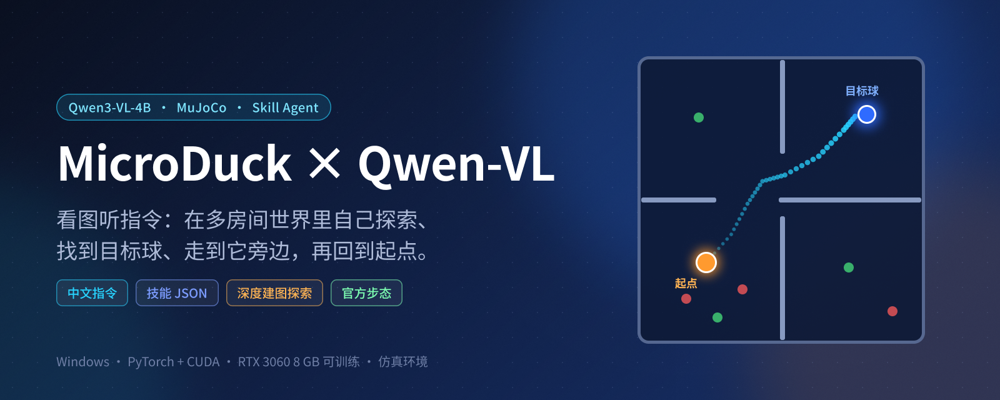
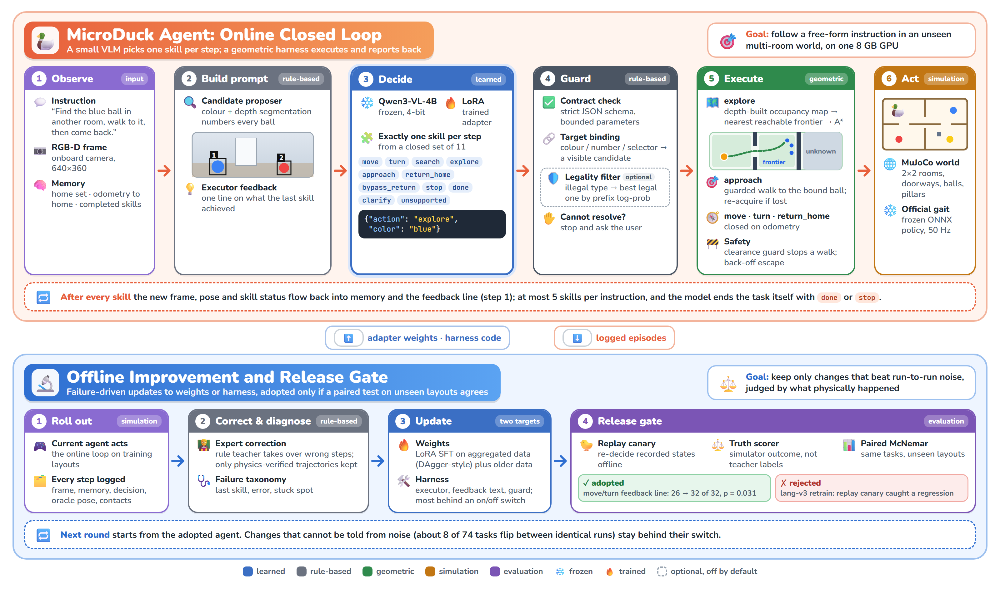

<p align="center">
  
</p>

<p align="center">
  <b>一句中文指令，一张图，一个技能 JSON。</b><br>
  视觉语言模型负责「看图 + 理解指令 + 选技能」，路径、避障与步态交给几何规划和冻结的官方策略。
</p>

---

## 最终效果

<p align="center">
  
</p>

指令「去别的房间找蓝色的球，走到它旁边，然后回起点」：模型依次输出 `explore → approach → return_home → done`，机器人用深度图增量建图、朝最近的可达前沿探索，看到蓝球后走近，再回到起点（最终距起点约 8 cm）。画面左上为俯视全景（橙点是机器人，蓝点是走过的路），右侧是模型实际看到的带编号画面和机器人第一视角。GIF 为 5 倍速、全程无人工接管；这是一次成功的单次运行，不是成功率。

在 2×2 房间世界里，对 80 个留出任务的独立物理评测：

| | 总成功率 | 去别处找球 |
|---|---:|---:|
| 改进前 | 52/80（65%） | 20/48 |
| 当前 | **69/80（86%）** | **41/48（85%）** |

提升主要来自建图与导航执行层，而不是重训；从 52 到 69 的总提升经成对检验（McNemar）是显著的（p=0.002），但之后各步更小的差别在 80 个任务上分不出。结果来自两组种子、单一世界等级的仿真评测；位姿与安全真值取自仿真，没有真机验证。

### harness 有多大作用

在 16 个从没用过的布局、同样 80 个任务上，按仿真真值（机器人是否真的到了球旁边、回到起点、没碰东西）评分：

| 配置 | 真值成功率 |
|---|---:|
| 不加 harness：冻结 Qwen3-VL-4B 直接控制，只能 `move`/`turn`/`stop`/`done`，每个任务最多 40 步 | **0/80（0%）** |
| 加 harness：同一个冻结模型，用技能、建图导航和校验 | 27/80（34%） |
| 加 harness + 两行结束规则（不训练） | 68/80（85%） |
| 加 harness + LoRA（lang-v2） | **74/80（92.5%）** |

- 没有 harness 时，模型在 2661 次决策里一次都没输出过 `done` 或 `stop`，45% 的前进被判为不安全而拒绝（反复撞同一面墙）。
- 即使替它在最合适的时刻喊停，去别的房间找球也是 0/48：机器人离目标最近时的中位距离仍有 3.4 米。
- 同一个冻结模型加上 harness，在同样「最合适时刻喊停」的假设下是 74/80。它的主要毛病是做完了不停，一条结束规则就把成功率从 27 拉到 68。
- 剩下到 74 的差距才是 LoRA 的贡献，在 80 个任务上和结束规则的版本分不出显著差别（p = 0.18）。

结论：在这组任务上，能不能做成几乎完全取决于 harness，训练主要补的是「什么时候结束」。局限：只测了一个 4B 模型和一版没调过的提示；结束规则是在同一批种子上定的，还没在新种子上确认。细节见 [experiments/lang-v1/summary.md](experiments/lang-v1/summary.md) 和 [docs/improvement-evidence.md](docs/improvement-evidence.md) 第 19–21 行。

## 架构

<p align="center">
  
</p>

上半部分是在线闭环：每执行完一个技能，就把新的画面、位姿和技能状态写回记忆与执行器反馈，再让模型选下一个技能，每条指令最多 5 步，由模型自己用 `done` 或 `stop` 结束。下半部分是离线改进：改动可以是 LoRA 权重，也可以是 harness 代码，都要先过回放金丝雀、仿真真值评分和留出布局上的成对检验，才会被采用。虚线框是默认关闭的可选模块。图的源文件是 [assets/paper/architecture_overview.html](assets/paper/architecture_overview.html)，用 `bash tools/render_figure.sh` 重新生成；论文用的矢量版（TikZ）在 [assets/paper/architecture_acl.tex](assets/paper/architecture_acl.tex)。

- 模型：`Qwen/Qwen3-VL-4B-Instruct` + LoRA，每步只输出一个技能：`move` · `turn` · `approach` · `search` · `explore` · `return_home` · `stop` · `done` · `clarify` · `unsupported` · `bypass_return`。
- 执行：深度图建图 + 前沿探索 + A* 路径，净空过小时护栏停车；官方 ONNX 步态跑在 MuJoCo 里。
- 训练：专家纠错数据聚合（模型自己做，专家只在出错时接管，只有物理验证通过的轨迹进入训练），命令与格式见 [AGENT_TRAINING.md](docs/AGENT_TRAINING.md)；逐步实验记录见 [experiments/lang-v1/summary.md](experiments/lang-v1/summary.md)，借鉴的论文见 [docs/related-work.md](docs/related-work.md)。

## 快速开始

需要 Windows、Python 3.12 与匹配驱动的 CUDA（RTX 3060 8 GB 即可训练和推理）。

```powershell
python -m venv .venv
.venv/Scripts/python.exe -m pip install torch==2.11.0 torchvision==0.26.0 --index-url https://download.pytorch.org/whl/cu128
.venv/Scripts/python.exe -m pip install -e '.[vision-torch,simulation]'
.venv/Scripts/python.exe -X utf8 -m microduck_qwen.vision download
.venv/Scripts/python.exe -m unittest discover -s tests -v
```

仿真依赖放在仓库同级目录：`../microduck_rl/.venv/`（MuJoCo、ONNX Runtime、官方 body server）与 `../duck-sim-state/policies/current/`（官方 ONNX 策略）。

录制上面的演示（权重不随仓库分发，先按 [AGENT_TRAINING.md](docs/AGENT_TRAINING.md) 训练 `adapters/lang-v2`）：

```bash
bash scripts/record_demo_world.sh adapters/lang-v2 98107
```

复现留出评测（80 个任务，两组种子各 8 个布局），并用成对检验比较两次评测：

```bash
bash scripts/eval_world.sh adapters/lang-v2 data/lang-v2 eval
python -m microduck_qwen.compare_runs runs/lang/eval-98000 runs/lang/eval-98100 --b runs/lang/other-98000 runs/lang/other-98100
```

仓库结构：`microduck_qwen/` 源码，`tests/` 测试，`scripts/` 评测与数据/训练流程脚本，`tools/` 诊断工具，`docs/` 文档（`docs/archive/` 是早期实验的历史文档），`experiments/` 实验记录，`assets/` 图与演示。

---
