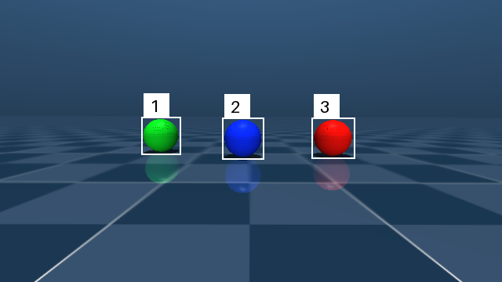
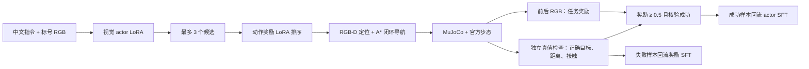

# Windows 视觉选目标与闭环导航实验

本轮使用 Qwen3-VL-2B-Instruct 的真实 RGB 输入，输出球的候选编号或停止/拒绝状态；RGB-D 将选中的球定位到世界坐标，已有 A*、闭环控制和官方 ONNX 步态负责移动。视觉模型不生成关节动作。所有命令从仓库根目录执行，路径均相对该目录。

## 本机查看

准备好本机权重与官方仿真资产后，终端一运行：

```powershell
.venv/Scripts/python.exe -X utf8 -m microduck_qwen.sim_native --vision --viewer --seed 230000 --port 7846 --manifest runs/vision-simulator.json
```

终端二运行（停止或不支持的指令也可直接输入）：

```powershell
.venv/Scripts/python.exe -X utf8 -m microduck_qwen.vision chat --adapter adapters/vision-torch-static-control
```

输入 `走到画面左边的球旁边` 或 `走到红色球旁边`。仅查看模型选择可用 `vision plan '走到画面左边的球旁边' --adapter adapters/vision-torch-static-control`，观察图保存于 `runs/vision/`。省略 `--adapter` 使用冻结基座；部署入口的可见性与语义保护可能拒绝模型输出，不能将保护后的行为算成模型本身正确。

下图为实际采集的第一视角 RGB，候选框和编号由颜色检测产生，图中没有真值坐标或物体名称：



## 训练方法与 UI-Genie 的关系

参考 [UI-Genie 论文](https://arxiv.org/abs/2505.21496) 与[作者实现](https://github.com/Euphoria16/UI-Genie)：训练动作/任务奖励模型，奖励引导候选探索，收集成功轨迹再次 SFT，使用失败候选与截断轨迹更新奖励模型。这不是 PPO。

本项目做有预算的适配：同一个冻结 Qwen3-VL 基座分别训练 actor 与奖励 LoRA；动作奖励接收 RGB、指令与候选 JSON，任务奖励接收执行前后两张 RGB 和指令，输出单 token `yes/no` 概率。专家成功轨迹产生正例，真实尚未到达的中途帧产生截断负例；每条指令增加两个不同的错误候选。探索在 8 个新训练布局中最多采样 3 个候选、保留 1 个，由实际仿真结果独立核验，且奖励概率至少 0.5 才进入 actor 回流。奖励模型误接受的错误候选保留为 hard negative。

与原论文的差别：本轮是一次高层选球决策，未复现完整 GUI 历史交错、10 候选/top-5 beam、5 次后续 rollout 标注或三轮递增任务。原论文采用 Qwen2.5-VL，本轮采用 Qwen3-VL-2B；不能称为完整复现。



真值分割、物体名称及真实目标坐标不输入 actor 或奖励模型。导航仍依赖仿真位姿、相机外参与地图，因此本实验不是纯视觉定位，也不证明能迁移到真机。

## 数据与对照

40 个独立随机布局按场景划分为训练 24、验证 8、测试 8；覆盖颜色、左右选择、部分/完全遮挡、目标缺失、停止和不支持的指令。训练 486 行包含同一布局内的轨迹帧，不能当作 486 个独立场景；验证、测试各 56 行。训练中有 12 条独立核验成功的专家导航轨迹。

每个布局使用相同的 7 条指令模板，包括 `停下来` 与 `请画一幅画`。本轮隔离场景种子，未隔离语言模板，因此停止/不支持项的提升不能证明对陌生措辞或新任务的泛化。

采集时关闭 MSAA，防止边缘混色污染 MuJoCo 编码分割 ID；旧 `windows-vision-v1` 数据和 smoke 权重仅保留为诊断，不进入正式实验。正式数据为 `data/windows-vision-v2`，清单哈希和预定预算见 [protocol.json](experiments/windows-vision-v2/protocol.json)。预算在正式训练前固定，回流比例/阈值在探索前固定；测试在全部训练分支完成后运行，不用于调参。

比较冻结基座、首轮 actor R0（100 步）、静态 SFT 对照（R0 再训练 100 步）与奖励筛选回流 R1（R0 再训练 100 步）。后两者 actor 总步数均为 200，均重建优化器；回流重复采样到约占一半训练行。奖励模型额外训练 50+50 步，探索亦为额外成本，因此不是总算力相等的对照。

QLoRA：NF4 double quant、BF16、最后 8 个语言层 q/v 投影 rank 8、458,752 个可训练参数、batch 1、学习率 5e-5、随机种子 42；视觉塔冻结。图文前缀全部 mask，只计算答案及 EOS 损失；超长样本拒绝静默截断。适配器哈希、父权重、数据哈希、变更张量数与显存峰值写入训练报告。

## 实测结果

固定独立测试的总体正确数为：基座 33/56、R0 41/56、静态 SFT 49/56、回流 R1 49/56；后两者验证集也都为 50/56。全部分支输出合法率为 100%，但颜色/左右选球均为 33/40。因此本轮收益来自停止及不支持指令，尚未观察到视觉选目标本身的提升。交互示例选用静态 SFT，这是在测试前依据验证集平局确定的，见 [选择记录](experiments/windows-vision-v2/deployment-selection.json)。

静态 SFT 与回流 R1 对 34 条真正可见目标指令均正确 33 条；对需要拒绝的 4 条部分遮挡、2 条目标不可见指令均为 0 条正确。不能仅凭 87.5% 总体分数认为视觉拒绝能力可靠。

固定物理测试结果如下；到达要求同时满足选择正确、执行成功、真实目标距离不超过 0.35 m、未记录场景接触。需要拒绝的案例不计作成功导航：

| 分支 | 全部任务成功 | 可见目标导航成功 | 部分遮挡判断正确 |
| --- | --- | --- | --- |
| 基座 | 5/6 | 5/5 | 0/1 |
| R0，100 步 | 4/6 | 4/5 | 0/1 |
| 静态 SFT，200 步 | 5/6 | 5/5 | 0/1 |
| 回流 R1，200 步 | 5/6 | 5/5 | 0/1 |

四组都未记录场景接触；部分遮挡案例均由 RGB-D 可见性保护阻止移动，不能算模型正确拒绝。R0 另有一次走到错误球的失败，真实目标距离约 0.571 m，尽管执行器报告已到达它收到的坐标。`full` 场景中的左右指令选择当前画面可见球，不表示到达被完全遮挡的球。这组每模型仅 6 次试验，不支持统计显著或普遍可靠的结论。

探索实际得到 4/8 个核验成功样本、16 条奖励样本，其中 1 条动作 hard negative。虽然每个布局采样 3 次，全部布局去重后均仅 1 个候选，奖励排序没有多样动作可选；4 条成功回流样本上采样也容易过拟合，不能将本轮称为有效的自主能力增长。

动作奖励模型独立测试使用 56 个正确候选和 112 个反事实错误候选。R0 总体正确 139/168（82.7%）、正确候选接受 34/56、错误候选误接受 7/112；R1 分别为 140/168（83.3%）、30/56、2/112。更新后更保守，但正确候选召回也下降；这不是任务完成奖励的独立评测，不能据此宣称整个奖励系统可靠。探索日志保留去重候选，重复采样的原始文本未逐次保留。

训练中全部 32 个 LoRA 张量实际变化。actor 的 PyTorch 分配显存峰值约 1.95 GiB，奖励训练约 2.09 GiB；这不包含其他应用、CUDA 上下文或显存保留池，不能当成整机总显存用量。

额外通过正常 MSAA 渲染、关闭采集真值端点的 `vision run` 交互冒烟：约 7.74 秒、路径约 1.16 m，最终距 RGB-D 目标约 0.318 m。这是训练布局上的入口检查，不计入上述独立测试，见 [记录](experiments/windows-vision-v2/deployment-smoke.json)。完整指标、全部测试原始输出、失败记录与五份训练报告见 [实验摘要](experiments/windows-vision-v2/summary.json) 及其同目录文件。

完整单元测试 59 项通过，包括真实 MuJoCo 分割框回归、图文 completion mask、双图输入、奖励反事实标签与评测器适配器元数据序列化；旧视觉评测入口在 Windows 上另做了单样本运行检查。

## 重现实验

先按 README 准备 Python 3.12 与官方仿真资产；本轮使用匹配的 CUDA 12.8 wheel：

```powershell
.venv/Scripts/python.exe -m pip install torch==2.11.0 torchvision==0.26.0 --index-url https://download.pytorch.org/whl/cu128
.venv/Scripts/python.exe -m pip install -e '.[vision-torch,simulation]'
.venv/Scripts/python.exe -X utf8 -m microduck_qwen.vision download
.venv/Scripts/python.exe -X utf8 -m microduck_qwen.vision_data --output data/windows-vision-v2 --train-scenes 24 --valid-scenes 8 --test-scenes 8 --seed-offset 200000 --navigate
.venv/Scripts/python.exe -X utf8 -m microduck_qwen.vision_torch train --data data/windows-vision-v2 --output adapters/vision-torch-r0 --steps 100
.venv/Scripts/python.exe -X utf8 -m microduck_qwen.vision_torch train --data data/windows-vision-v2 --output adapters/vision-reward-r0 --task reward --steps 50
.venv/Scripts/python.exe -X utf8 -m microduck_qwen.vision_torch train --data data/windows-vision-v2 --output adapters/vision-torch-static-control --resume adapters/vision-torch-r0 --steps 100
.venv/Scripts/python.exe -X utf8 -m microduck_qwen.vision_explore --data data/windows-vision-v2 --adapter adapters/vision-torch-r0 --reward adapters/vision-reward-r0 --output runs/windows-vision-v2/exploration-r0 --explore
.venv/Scripts/python.exe -X utf8 -m microduck_qwen.vision_torch train --data data/windows-vision-v2 --output adapters/vision-reward-r1 --task reward --steps 50 --resume adapters/vision-reward-r0 --extra runs/windows-vision-v2/exploration-r0/reward-replay.jsonl
.venv/Scripts/python.exe -X utf8 -m microduck_qwen.vision_torch train --data data/windows-vision-v2 --output adapters/vision-torch-r1 --steps 100 --resume adapters/vision-torch-r0 --extra runs/windows-vision-v2/exploration-r0/actor-replay.jsonl
```

评测命令示例；更换适配器和输出名可运行全部对照，省略适配器是基座：

```powershell
.venv/Scripts/python.exe -X utf8 -m microduck_qwen.vision_torch evaluate --data data/windows-vision-v2 --adapter adapters/vision-torch-r1 --split test --output runs/windows-vision-v2/r1-test.json
.venv/Scripts/python.exe -X utf8 -m microduck_qwen.vision_torch evaluate-reward --data data/windows-vision-v2 --adapter adapters/vision-reward-r1 --split test --output runs/windows-vision-v2/reward-r1-test.json
.venv/Scripts/python.exe -X utf8 -m microduck_qwen.vision_explore --data data/windows-vision-v2 --adapter adapters/vision-torch-r1 --output runs/windows-vision-v2/physical-r1
.venv/Scripts/python.exe -X utf8 -m unittest discover -s tests -q
```

数据、权重和原始日志不随 Git 发布；目标目录已存在时拒绝覆盖，重跑请使用新目录。物理时间、摄像头采样与 GPU 采样可能造成复跑差异，固定种子不保证逐位一致。
